# AI PBX — Installation & Deployment Guide

This guide covers installing and configuring **AI PBX** on **Ubuntu 26.04 LTS**.

> 📺 **Prefer to watch?** The installation step by step, narrated and subtitled:
> [English](https://www.youtube.com/watch?v=lH1-k_z5jFE) · [Türkçe](https://www.youtube.com/watch?v=eDHHHW6ZcvQ) ·
> [Deutsch](https://www.youtube.com/watch?v=1QuOM6Rtcbg) — more on the [AiPBX YouTube channel](https://www.youtube.com/@aipbx).

---

## System Requirements

- **Operating System**: Clean Ubuntu Server (26.04 LTS x86_64)
- **Minimum Specs**: 2 GB RAM, 2 vCPU, 15 GB SSD storage
- **Recommended Specs (Production)**: 4 GB+ RAM, 4 vCPU, 40 GB+ NVMe SSD
- **Network**: Static Public IPv4 and/or configured FQDN (e.g. `pbx.company.com`)
- **Privileges**: Root access (`sudo -i`)

---

## 🚀 1. Quick Automated Install (Recommended)

The installer sets up Asterisk 22, MariaDB, the web portal, the 443 edge (nginx + Apache), coturn,
the Go chat service and the security tooling in one command. It installs the **latest published
release** (see [CHANGELOG.md](CHANGELOG.md)).

```bash
curl -fsSL https://raw.githubusercontent.com/mahirgul/AiPBX/main/install.sh | sudo bash
```

Or clone manually:

```bash
git clone https://github.com/mahirgul/AiPBX.git /opt/aipbx
cd /opt/aipbx
git checkout "$(git tag -l 'v*' --sort=-v:refname | head -1)"   # latest release
sudo bash install.sh
```

Useful variables: `AIPBX_FQDN=pbx.example.com` (skip the domain prompt), `AIPBX_REF=main` (install the
development branch instead of the latest release), `AIPBX_INSTALL_DIR` (default `/opt/aipbx`).

### What the installer automates:
1. **Interactive FQDN & TLS Provisioning**: Prompts for your domain. If your DNS is pointed to the server, it obtains a free **Let's Encrypt TLS** certificate via Certbot. If you do not have an active domain yet, it automatically provisions a secure **self-signed TLS certificate** with SAN support.
2. **Dynamic Cryptographic Credentials**: Automatically generates unique, random secrets for:
   - MariaDB application runtime user (`aipbx_portal`)
   - MariaDB schema migration user (`aipbx_migrator`)
   - Asterisk Manager Interface user (`aipbx-manager`)
   - Asterisk → MariaDB ODBC user (`asterisk_odbc`, CDR and queue_log)
   - coturn WebRTC TURN secret key
   - Web portal initial `admin` user
3. **Software Stack Setup**: Installs Asterisk 22, MariaDB, nginx, Apache 2.4 + PHP 8 with all necessary extensions, Go, coturn, firewalld and fail2ban.
4. **Database Migration**: Builds (or upgrades) the schema with the Phinx migrations in `web/db/migrations` and loads initial data from `db/seed.sql`; creates the ODBC user Asterisk uses to write CDRs and queue logs.
5. **Edge & Reverse Proxy**: nginx on 443 routes TLS by ALPN to Apache (portal, `/ws` Asterisk WebRTC, `/chat/*` chat service) or coturn (TURNS), passing the real client address with the PROXY protocol.
6. **Credential Safe**: Prints full credentials in a formatted terminal summary and writes a protected file to `/root/aipbx-credentials.txt` (`chmod 600`).

---

## 🌐 2. How Traffic Flows



- nginx stream config: `/etc/nginx/aipbx-stream.conf`
- Apache virtual host: `/etc/apache2/sites-available/aipbx.conf`
- Apache only listens on loopback for HTTPS, so client addresses come from the PROXY protocol header
  (fail2ban, login throttling and audit logs see the real IP).

These files are managed by the installer and rewritten on every update — do not edit them by hand.

---

## 🔒 3. Post-Installation & Verification

### 3.1 Access the Management Portal
Open your browser and navigate to:
```
https://<your-server-ip-or-domain>
```
Log in using:
- **Username**: `admin`
- **Password**: *(Found in `/root/aipbx-credentials.txt`)*

### 3.2 Service Health Check
Run the following command to verify that all system services are active and running:
```bash
systemctl status asterisk mariadb nginx apache2 coturn aipbx-chat
```

### 3.3 Updating
Releases are published as git tags (`vX.Y.Z`, see `CHANGELOG.md`). To update an installation:

```bash
sudo aipbx-update --check   # installed vs. latest version
sudo aipbx-update           # update to the latest release
```

or from the portal: **System → System Update** (admin only). The update:
1. refuses to run when files under `/opt/aipbx` were edited by hand. Asterisk is restarted only when the release needs it (an
   Asterisk configuration file or package changed); then the update waits for an idle PBX (`--allow-calls` to force).
   Otherwise Asterisk is only reloaded and calls stay up. `--check` and the portal page say which applies;
2. backs up the database, `/etc/ai-pbx.env` and `/etc/asterisk` to `/var/backups/aipbx/` (last 5 kept);
3. checks out the release and runs `install.sh --upgrade` — database migrations, new packages and system settings are applied, **passwords, certificate, admin password and firewall choices are kept**;
4. verifies services, the portal and every page; on any failure it restores the previous code, database and settings automatically.

**Installations older than 1.50.0** are updated in two steps: `aipbx-update` first installs 1.50.0
(the bridge release, which carries the old-to-new migrations), then the latest release. It does both
steps in one run. An installation on 1.34.0–1.34.2 must
first run `sudo git -C /opt/aipbx checkout -- web/bin/aipbx_ops.php`, see
[Troubleshooting](docs/troubleshooting.md#system-update-fails-with-code-was-modified-by-hand).

Keep local customisations out of `/opt/aipbx` (use the portal, `/etc/ai-pbx.env` and `*_custom.conf` files) — they survive updates.

### 3.4 Firewall (firewalld)
The installer configures **firewalld** and disables `ufw` (running both makes one
close what the other opens). Afterwards, manage ports and allowed networks from the
portal's **Firewall** page, or with `firewall-cmd`. Ports opened by default:

| Port | Purpose |
|------|---------|
| 80/tcp, 443/tcp | Portal, WebRTC (WSS `/ws`), chat; TURNS too with `TURNS_PORT=443` ([WebRTC, NAT and TURN](docs/webrtc-nat.md)) |
| 5060/udp+tcp, 5061/tcp | SIP / SIP-TLS |
| 10000-20000/udp | RTP media |
| 4100-4999/udp | T.38 fax (UDPTL) |
| 3478/udp+tcp, 5349/udp+tcp | STUN/TURN |
| 49152-65535/udp | TURN relay media |

Do not enable `ufw` on top of this.

**Recommended:** if only your carrier and local phones use SIP, allow 5060/5061 only from those
addresses instead of the whole internet — see [docs/security.md](docs/security.md#firewall).

### 3.5 Certificates
One certificate serves the portal, TURNS and SIP-TLS. Manage it on **Security → Certificates**: get a
Let's Encrypt certificate (the domain in `PORTAL_DOMAIN` must point to the server and port 80 must be
reachable), upload your own (PEM or PFX/P12), or go back to self-signed. Renewals are applied to
Apache, coturn and Asterisk automatically. The same operations are available as `sudo aipbx-cert …`.
A self-signed certificate breaks WebRTC TURNS — see [docs/certificates.md](docs/certificates.md).

### 3.6 E-mail Relay
Fax-to-e-mail, voicemail notifications and invitations are sent through postfix. Set your relay on
**System → E-Mail** — see [docs/mail.md](docs/mail.md).

### 3.7 Backups
`aipbx-backup` runs every night at 02:30 (`/etc/cron.d/aipbx`) and writes
`/var/backups/aipbx-daily/aipbx-YYYYmmdd-HHMM/` with a full database dump (`db.sql.gz`) and
`config.tgz` (`/etc/ai-pbx.env`, `/etc/asterisk`, uploaded sounds, music on hold, certificates,
the settings key `/var/lib/aipbx/settings.key` and the AI service token `/etc/aipbx/ai.token`).
The settings key decrypts the secrets kept in the database (cloud AI and TTS keys, S3, mail): restore
it together with the database, or those secrets have to be entered again. The backup is readable by
root only; keep off-server copies just as private. Backups older than 14 days are removed. Optional settings in `/etc/ai-pbx.env`:

| Setting | Default | Purpose |
|---------|---------|---------|
| `AIPBX_BACKUP_DIR` | `/var/backups/aipbx-daily` | where backups are written |
| `AIPBX_BACKUP_KEEP_DAYS` | `14` | retention |
| `AIPBX_BACKUP_COPY_TO` | — | rsync destination for an off-server copy (`user@host:/path`, root's SSH key) |

Run one by hand with `sudo aipbx-backup`; results are logged to `/var/log/aipbx/backup.log`.
Call recordings are not included — copy `/var/spool/asterisk/monitor` separately. Restore a database
with `zcat db.sql.gz | sudo mysql` and the files with `sudo tar xzf config.tgz -C /`. Other databases on the same server are not backed up.

### 3.8 Next Steps
Trunks, routes, roles, recordings, sounds and troubleshooting: [documentation](docs/README.md).

---

## 📁 Key File Locations

| Purpose | File Path |
|---------|-----------|
| Installed code (git checkout of a release) | `/opt/aipbx` (`VERSION` = installed version) |
| Generated credentials (delete after noting) | `/root/aipbx-credentials.txt` |
| Service secrets | `/etc/ai-pbx.env` (`640 root:asterisk`) |
| Web document root | `/var/www/html` → `/opt/aipbx/web` |
| Generated Asterisk configuration | `/etc/asterisk/pbx/` |
| nginx 443 edge | `/etc/nginx/aipbx-stream.conf` |
| Apache virtual host | `/etc/apache2/sites-available/aipbx.conf` |
| coturn | `/etc/turnserver.conf` |
| Chat service unit | `/etc/systemd/system/aipbx-chat.service` |
| Root helper used by the portal | `/usr/local/sbin/aipbx-priv` |
| Updater | `/usr/local/sbin/aipbx-update` |
| Update backups / log | `/var/backups/aipbx/` · `/var/log/aipbx/update.log` |
| Daily backups / log | `/var/backups/aipbx-daily/` · `/var/log/aipbx/backup.log` |
| Fax archive | `/var/www/faxes/` |
| Call recordings (converted to MP3 every 5 min) | `/var/spool/asterisk/monitor/` |
| Uploaded / Turkish sounds | `/var/lib/asterisk/sounds/custom/` · `/var/lib/asterisk/sounds/tr/` (from the `asterisk-core-sounds-tr-*.tar.xz` packages) |
| Apache sandbox override | `/etc/systemd/system/apache2.service.d/override.conf` |
| Portal fail2ban overrides | `/etc/fail2ban/jail.d/zz-ai-pbx.local` |
| Maintenance cron jobs | `/etc/cron.d/aipbx` |
