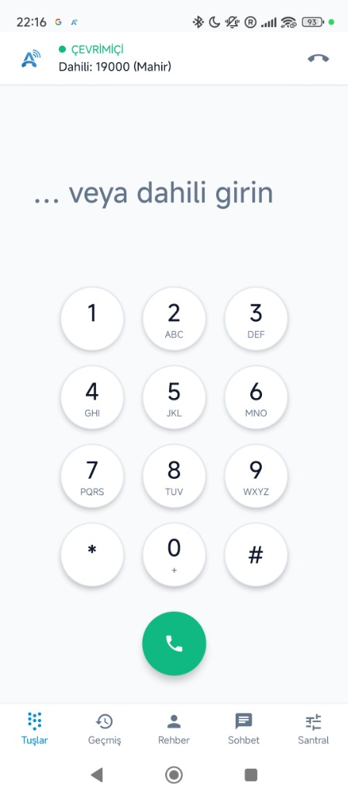
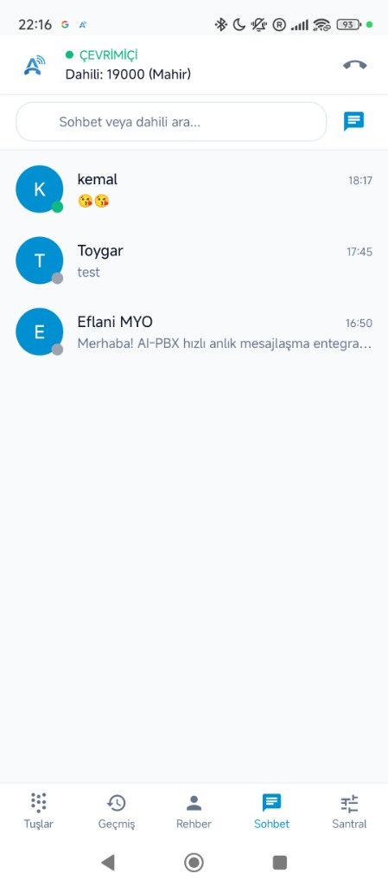
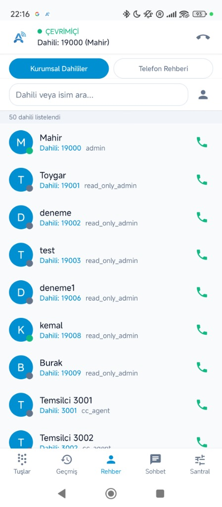
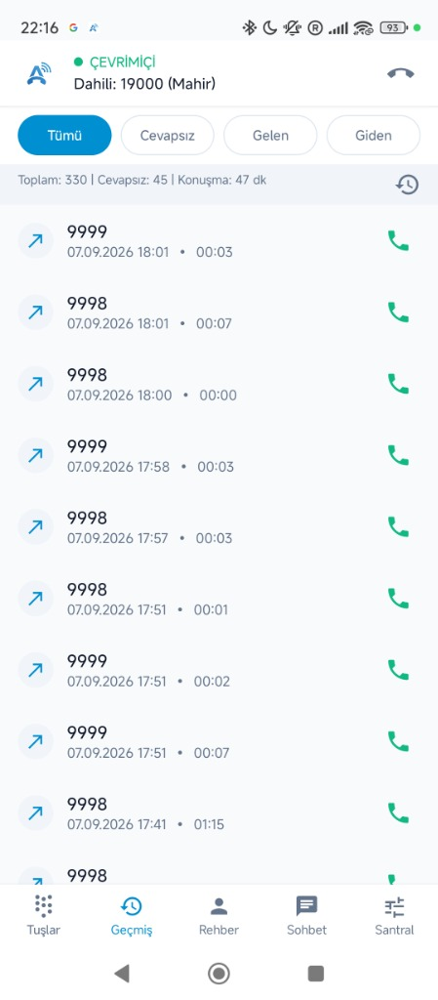
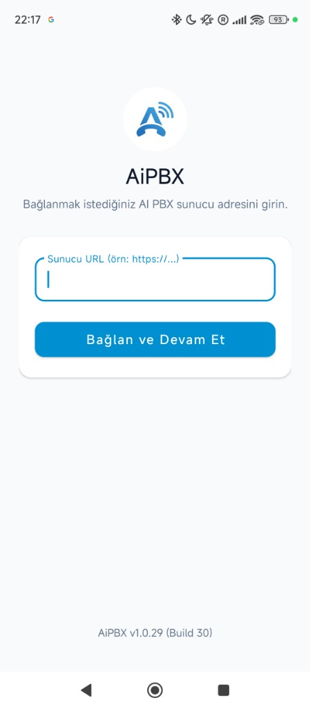

<p align="center">
  <a href="https://aipbx.bid">
    
  </a>
</p>

<p align="center">
  <strong>Open-Source Enterprise IP PBX Management Portal & Unified Communications</strong><br>
  Asterisk 22 · PHP 8 · MariaDB · WebRTC · Instant Messaging · Android & iOS Apps
</p>

<p align="center">
  📖 <a href="docs/README.md"><strong>Documentation</strong></a> · 🌐 <a href="https://aipbx.bid"><strong>Website: aipbx.bid</strong></a>
</p>

<p align="center">
  <a href="https://github.com/mahirgul/AiPBX/releases/latest"></a>
  <a href="https://github.com/mahirgul/AiPBX/blob/main/LICENSE"></a>
  <a href="https://github.com/sponsors/mahirgul"></a>
  
  
  
  
  <a href="docs/README.md"></a>
</p>

<p align="center">
  <a href="#-quick-install">🚀 Quick Install</a> •
  <a href="#-updating">🔄 Updating</a> •
  <a href="#-features">✨ Features</a> •
  <a href="#-global-privacy--telecom-compliance-privacy">🛡️ Privacy & GDPR/KVKK</a> •
  <a href="docs/README.md">📚 Documentation</a> •
  <a href="#-architecture">🏗️ Architecture</a> •
  <a href="CHANGELOG.md">📋 Changelog</a> •
  <a href="docs/roadmap.md">🗺️ Roadmap</a> •
  <a href="#-contributing">🤝 Contributing</a> •
  <a href="#-sponsor">💖 Sponsor</a> •
  <a href="#️-disclaimer--legal-notice--sorumluluk-reddi">⚖️ Disclaimer</a>
</p>

---

## 🚀 Quick Install

```bash
# One-liner installation (installs the latest release)
curl -fsSL https://raw.githubusercontent.com/mahirgul/AiPBX/main/install.sh | sudo bash
```

Or clone manually and install the latest release:

```bash
git clone https://github.com/mahirgul/AiPBX.git /opt/aipbx
cd /opt/aipbx
git checkout "$(git tag -l 'v*' --sort=-v:refname | head -1)"
sudo bash install.sh
```

The installer:
1. 🌐 Asks for your **FQDN** — with Let's Encrypt if DNS points to the server, otherwise a self-signed
   certificate; leave it blank for a LAN-only install announced as `aipbx.local` via mDNS
2. 🔑 Generates **strong random secrets** for every service (no default passwords)
3. ⚙️ Installs and configures Asterisk, MariaDB, Nginx + Apache, PHP, coturn, the Go chat service,
   firewalld and fail2ban, and builds the database from migrations
4. 📄 Prints the credentials and saves them to `/root/aipbx-credentials.txt`

> 💡 **Requirements**: Ubuntu 26.04 LTS · 2 GB RAM · 10 GB disk · root access
>
> 🛠️ **Developers**: `AIPBX_REF=main` installs the current development branch instead of the latest release.

After installing, open `https://<your-server>` and log in with the admin credentials shown.

---

## 🔄 Updating

Releases are published as git tags (`vX.Y.Z`) with notes in [CHANGELOG.md](CHANGELOG.md).

```bash
sudo aipbx-update --check   # installed vs. latest release
sudo aipbx-update           # update to the latest release
```

Or from the portal: **System → System Update** (admin only) shows the installed and latest version, the
release notes and an **Update** button with live progress. A new release is also checked for every night.

Every update:
- 🛡️ refuses to start during active calls (Asterisk is restarted) or over hand-edited code;
- 💾 backs up the database, `/etc/ai-pbx.env` and `/etc/asterisk` to `/var/backups/aipbx/`;
- 🔄 applies database migrations, new packages and system settings **without touching passwords,
  certificates, the admin password or your firewall choices**;
- ✅ verifies services, the portal and every page — and **rolls back automatically** (code, database
  and settings) if anything fails.

Keep customisations out of `/opt/aipbx` (use the portal, `/etc/ai-pbx.env` and `*_custom.conf`
files) so they survive updates. See [INSTALL.md](INSTALL.md) for details.

---

## ✨ Features

### 📞 PBX Management
- **Extension management** — PJSIP-based, one number on desk phone, browser and mobile at once
  (SIP + WebRTC + mobile endpoints)
- **Calling permission groups (call barring)** — prefix and exact-match rules (`0`, `05`, `00`),
  per-extension assignment, default allow-all
- **Voicemail** — Asterisk voicemail with unconditional / busy / no-answer / unavailable triggers,
  managed in *My Phone* or with feature codes (`*97` own mailbox, `*98` mailbox login), in-browser player
- **Boss – secretary groups** — executive interception, simultaneous or sequential secretary ringing,
  VIP whitelist bypass, automatic failover
- **Ring groups** — virtual numbers mixing extensions and external numbers, simultaneous or sequential
- **Conference rooms** — ConfBridge with PINs, wait-for-leader, join muted and live web moderation (mute/kick)
- **Trunks** — IP or registration based, tabbed settings, copy, rename and drag-and-drop ordering;
  inbound DID trimming, transit routing between PBXes and carriers, per-trunk **outbound caller ID
  normalization** (keep last N digits + prefix, e.g. extension `7840` → `903704187840`)
- **Outbound routes** — Asterisk patterns, strip/prepend, trunk failover chain, route groups for PBXes
  with different number formats, copy and ordering, duplicate patterns rejected
- **DID routing, time conditions, multi-level IVR**
- **Queues** — dynamic agent login/logout, static agents, hold music, recording
- **Feature codes** — `*81`/`*80` queue login/logout, `*72` call forward, `*60` DND, `*43` intercom,
  `*90`/`*91`/`*92` spy/whisper/barge, `*97`/`*98` voicemail
- **In-band disconnect supervision** — disconnect-tone detection for analog/legacy trunks
- **Safe apply** — generated configuration is reloaded atomically; a failed write or Asterisk reload is
  rolled back and the change stays pending
- **Live dashboard** — active calls and channels, callers waiting in queues, today's answered / missed
  calls and per-trunk channel usage, refreshed every 5 seconds
- **Complete Turkish prompt set** in one voice — every Asterisk core prompt plus voicemail, digits,
  conference, queue and directory prompts, so Turkish calls never switch to English halfway. Shipped
  as `asterisk-core-sounds-tr` packages in six formats (wav, ulaw, alaw, gsm and HD g722/sln16), so
  Asterisk plays the file matching the call's codec — and any Asterisk server can use them
- **Call recordings** — converted automatically to mono 16 kbps MP3 (~8× smaller than WAV), played in
  CDR reports, *My Phone* and the apps

### 📠 Fax
- **Inbound/outbound fax** — T.38 and G.711 (res_fax + SpanDSP)
- **Compose in the browser** (rich-text editor) or **upload a PDF**; resend failed faxes
- **E-mail notification** with the fax attached; per-DID recipients

### 📊 Call Center & Supervision
- **Agent desk and wallboard** — live queues, waiting callers (with pickup), agent states
  (idle / ringing / in call / on break), SLA, answered / missed / abandoned statistics
- **Breaks with reasons**, applied in Asterisk per queue, and break reports
- **Listen, whisper and barge** — from the wallboard or with `*90`/`*91`/`*92`
- **Call transfer** that keeps the caller connected through queue Local channels
- **Queue Report Centre** — service level, answered / lost calls, average wait and talk time per queue
  and per agent, lost calls with call-back tracking, repeat callers and call outcomes
- **Call reports and call journey** — calls grouped by linkedid with a step-by-step timeline; caller,
  inbound and outbound trunk, dialled number and direction (inbound / outbound / internal /
  trunk to trunk, transferred), recording playback with a waveform player
- **Branded PDF and Excel export** for every report, as filtered, with all rows

### 🌐 WebRTC Softphone
- **Browser phone** built into the portal header — no installation
- **TURNS (coturn)** relay for clients behind NAT and strict firewalls — clients use 443, which the
  nginx multiplexer hands to coturn (5349); per-user, time-limited credentials refreshed automatically
- **NAT handled in the generator** — public/private address mapping for ICE and every SIP transport;
  see [WebRTC, NAT and TURN](docs/webrtc-nat.md)
- **Opus + DTLS-SRTP** encrypted audio

### 💬 Messaging & Group Chat
- **1-to-1 and group chat** (Go WebSocket service `aipbx-chat`), group admins, member management
- **Photos and files** with thumbnails; access limited to the conversation's participants
- **Presence, typing indicators, read receipts**; push notifications on mobile

### 📱 Mobile Apps
- **Android** (Kotlin) — WebRTC calling with push wake-up and a foreground service, chat,
  directory with presence, call history, DND / call forward, in-app log viewer
- **iOS** (SwiftUI, CallKit) — calling with native incoming-call screen, chat, directory, features
- **Sign-in** with username + password (+ 2FA code), by scanning a QR code on the portal, or with the
  one-time link in the invitation e-mail

<p align="center">
  
  
  
  
  
</p>

### 🤖 AI & Dialplan Assistant
- **Cloud TTS** — turn text into speech with Google (API key or service account), Amazon Polly, Azure AI
  Speech, ElevenLabs or OpenAI; listen, download the MP3 or save it as an announcement in one click.
  Credentials are stored encrypted; usage is tracked per character
- **Dialplan Editor (`/assistant`) & Echo Reporter** — plain-language PBX change planner with dry-run preview before apply, safety validation, audit trail and one-click undo (`pbx_ai_changes`), plus the Echo diagnostic box backed by an opt-in local HEPv3 SIP signaling capture daemon (`aipbx-signaling` → `pbx_signaling_events`)

### 💼 Microsoft Teams Integration
- **Direct Routing** over SIP-TLS 5061 with SRTP
- **User ↔ extension mapping** (Microsoft 365 UPN, E.164)
- **Teams channel notifications** (missed calls, voicemail, queue alarms, faxes)
- **Generated PowerShell** setup scripts from your PBX configuration

### 🔌 REST API v1, Outbound Webhooks & Plugin System
- **Stateless REST API (`/api/v1/*`) & OpenAPI 3.1** — 100+ endpoints covering extensions, trunks, inbound/outbound routes, queues, ring groups, IVRs, time conditions, conferences, dial permissions, call center, CDRs, recordings, voicemails, faxes, phones, sounds, AI, chat, system settings, and sync
- **Scoped Bearer API Keys (`apbx_...`)** — per-token granular scopes (`extensions:read`, `calls:write`, `system:read`, …), IPv4/IPv6 CIDR allowlists, and per-minute sliding-window rate limits (`/api-keys`)
- **Outbound Webhooks (`/webhooks`)** — real-time event subscriptions (`call.started`, `call.answered`, `call.ended`, `voicemail.received`, `fax.received`, `sync.applied`, …) with `X-AiPBX-Signature` (`HMAC-SHA256`), exponential retry worker (`aipbx-webhook-worker`), and DNS-pinned SSRF protection
- **First-Class Plugin System (`/plugins`)** — zero-bloat modular integrations (`google-auth`, `ms-teams`, `web-widgets`, `auto-dialer`, `ai-cloud`, `ai-tts`, `ai-apps`, `ai-models`, `ai-voicemail`, `ai-assistant`, `signaling-capture`), dedicated `plg_*` MySQL table sandbox (`schema.sql`), custom `.zip` plugin uploader, encrypted secret storage, and **Safe Mode** circuit breaker (auto-disables any plugin after 5 consecutive runtime errors)
- **Auto Dialer & AMD Campaigns (`auto-dialer`)** — automated outbound calling campaigns with Asterisk Answering Machine Detection (`AMD()`), global & per-campaign AMD tuning, queue free-agent pacing, voicemail drop (`WaitForSilence`), and CSV call outcome export

### 🛡️ Global Privacy & Telecom Compliance (`/privacy`)
- **100% Opt-In by Default (`Off / Custom`)** — zero rules enforced unless explicitly enabled by an administrator under **Security → GDPR & Data Privacy** (**KVKK ve Veri Gizliliği** in Turkish); see [docs/privacy.md](docs/privacy.md)
- **One-Click Regulatory Presets** — instant templates for **KVKK (Turkey Law No. 6698 & BTK)**, **EU / UK GDPR**, **US CCPA / Two-Party & FCC (47 CFR § 64.1200)**, **HIPAA (Healthcare PHI)**, **PCI-DSS v4.0**, and **LGPD / PIPEDA / POPIA / PDPA**
- **Inbound Pre-Call Disclosure & Consent** — play a custom disclosure prompt (`notice`), allow DTMF **Opt-Out** (`Press 9 for unrecorded call` → sets `__PRIVACY_NO_RECORD=1` across DID routes, Queues & Ring Groups and tags `CDR(accountcode)=PRIVACY_OPTOUT`), or enforce **Explicit Consent Opt-In** (`Press 1 to allow recording`)
- **FCC Periodic Recording Beep** — configurable `MixMonitor(...,B(15))` periodic beep interval (5–60 seconds) during recorded calls
- **PCI-DSS & Live AGI/AI PII Redaction** — automatic Luhn-validated payment card (13–19 digits), CVV, and National ID (`REDACTED-CARD` / `REDACTED-ID`) masking on live AGI/AI transcripts and voicemail transcriptions before storage or external LLM calls
- **Automated Nightly Retention Purge (`privacy_purge.php`)** — independent retention windows (in days) for call recordings, voicemails + transcripts, faxes, chat messages, and dual-DB CDRs (`asteriskcdr` + `cdrs` anonymized as `REDACTED` so call volume statistics remain intact)
- **Subject Access Request (SAR) & Right to Erasure** — search any phone number or extension across dual CDR tables, recordings, voicemails, faxes, and SIP signaling events; download a portable **SAR JSON Data Package** (`PRIVACY_SAR_EXPORT`) or execute irreversible **Right to Erasure** (`PRIVACY_ERASURE`) with an immutable Audit Log certificate
- **Cross-Border Cloud AI Lock** — single toggle that blocks all outbound Cloud AI / STT / LLM calls (`CloudAiService::configured() === false`) so audio and transcripts never leave the local PBX server

### 🔐 Authentication & Security
- **Two-factor authentication (TOTP)** with offline QR codes and single-use recovery codes — enforced
  for portal, mobile and Google sign-in
- **Passkeys (WebAuthn / FIDO2)** — passwordless sign-in with biometrics or PIN
- **Google sign-in** (optional) with token audience and verified e-mail checks
- **Sessions revoked on password change** — mobile and chat tokens stop working immediately
- **User invitations** — generated passwords, forced first-login change, mobile sign-in link
- **RBAC** — built-in roles (admin, viewer, queue manager, agent, fax, **user** — the default) and custom
  roles with per-module permissions; security-critical pages are admin-only
- **Brute-force protection** — math CAPTCHA, account/IP lockout and a fail2ban jail using the real
  client address (PROXY protocol from the 443 edge)
- **Certificates page** — one certificate for portal, TURNS and SIP-TLS: Let's Encrypt (tested on
  staging first, renewed automatically), upload PEM or PFX/P12, or self-signed; problems that silently
  break WebRTC (self-signed, wrong name, missing chain) are flagged
- **Nightly backups** — database, configuration, and uploaded plugins (`aipbx-backup`, 14 days, optional off-server copy)
- **Firewall and fail2ban management** from the portal through a single, argument-validated root
  helper (`aipbx-priv`) — the portal never runs arbitrary commands as root
- **Hardening** — CSRF tokens, security headers, sandboxed uploaded files, Asterisk HTTP on loopback,
  Apache kept in Ubuntu's systemd sandbox with only the paths the portal needs opened

### 🌍 Multi-language & Mobile-Ready Portal
- **23 interface languages** including Turkish 🇹🇷 and English 🇬🇧 (5,000+ keys per language, 100% parity checked in CI)
- **Universal Live Filtering & Pagination** across all multi-record tables (extensions, trunks, routes, system users, audit log, call reports) and responsive mobile drawer/table layout

---

## 🏗️ Architecture

```
🌐 Internet ──443──▶ 🛡️ nginx (stream, ALPN, PROXY protocol)
                        ├─ 🔒 HTTPS / WSS ──▶ ⚙️ Apache + PHP (127.0.0.1:8443)
                        │                       ├─ 📞 /ws       ──▶ Asterisk WebSocket (127.0.0.1:8088)
                        │                       └─ 💬 /chat/…   ──▶ aipbx-chat (127.0.0.1:8086)
                        └─ 🎧 TURNS ─────────▶ coturn
            ──5060/5061, RTP──▶ ☎️ Asterisk 22 (PJSIP)  ──ODBC──▶ 🗄️ MariaDB (CDR, queue_log)
```

```
AiPBX/
├── web/                    # 🌐 PHP MVC portal & REST API v1
│   ├── src/
│   │   ├── core/           # Router, PluginManager, ApiRequestContext, ResourceNormalizer
│   │   ├── controllers/    # Page controllers + ApiV1Controller (+ api/ sub-handlers)
│   │   ├── services/       # Business logic, PrivacyService, DialplanService, ApiTokenService, WebhookService
│   │   ├── repositories/   # Database repositories
│   │   └── sync/           # Asterisk configuration generators
│   ├── templates/          # Layouts + views (including /privacy, /api-keys, /webhooks, /plugins)
│   ├── api/                # Portal JSON endpoints + /api/v1/* rewrite
│   ├── openapi.json        # OpenAPI 3.1 specification
│   ├── lang/               # 23 interface languages (100% key parity)
│   ├── db/migrations/      # Phinx migrations (the database schema)
│   └── tests/              # PHPUnit
├── plugins/                # 🔌 Official first-class plugins (auto-dialer, ms-teams, web-widgets, ai-*, …)
├── ai/                     # 🤖 Local & cloud AI service (aipbx-ai, Python)
├── chat/                   # 💬 Go WebSocket chat service (aipbx-chat)
├── android/                # 📱 Kotlin Android app
├── ios/                    # 🍎 SwiftUI iOS app
├── integrations/wordpress/ # 🧩 WordPress click-to-call & callback plugin
├── asterisk-config/        # ☎️ Asterisk base configuration
├── sounds/                 # 🔊 bundled custom sounds + Turkish prompt texts (core-sounds-tr.txt)
├── asterisk-core-sounds-tr-*.tar.xz  # 🇹🇷 Turkish prompts, one package per format (+ SHA256SUMS)
├── docs/                   # 📚 administrator & developer documentation
├── conf/sbin/              # 🔐 aipbx-priv (root helper), aipbx-update (updater)
├── db/seed.sql             # 🗄️ initial roles, permissions, settings
├── scripts/release.sh      # 🚀 publishes a release
├── install.sh              # 🛠️ installer (--upgrade mode used by aipbx-update)
├── VERSION · CHANGELOG.md
└── README.md · INSTALL.md · ARCHITECTURE.md
```

### 🧰 Technology Stack

| Layer | Technology |
|-------|-----------|
| ☎️ **PBX** | Asterisk 22 (PJSIP, res_fax, AMD, AMI, ODBC) |
| 🌐 **Web** | PHP 8, MVC, Composer; vanilla JS + CSS |
| 🗄️ **Database** | MariaDB (Phinx migrations + `plg_*` plugin sandbox) |
| 🛡️ **Edge** | nginx stream on 443 (ALPN + PROXY protocol) → Apache |
| 💬 **Chat** | Go + gorilla/websocket |
| 🎧 **WebRTC** | coturn TURN/STUN, DTLS-SRTP, Opus |
| 🤖 **Android** | Kotlin, WebRTC, FCM |
| 🍎 **iOS** | Swift, SwiftUI, CallKit |
| ⚙️ **CI** | GitHub Actions: PHPStan, PHPUnit, page smoke tests, Go tests, Android/iOS builds |

---

## ✅ After Installing

- 🔑 Credentials are in `/root/aipbx-credentials.txt` — note them and delete the file.
- 🔒 Service secrets live in `/etc/ai-pbx.env`.
- 📜 To switch a self-signed install to a Let's Encrypt or your own certificate, use **Security → Certificates** — see [docs/certificates.md](docs/certificates.md).
- 🔥 Ports and updating: [INSTALL.md](INSTALL.md).
- ✉️ Set an e-mail relay (fax-to-e-mail, voicemail, invitations): [docs/mail.md](docs/mail.md).
- 📖 Configuring trunks, routes, roles and more: [documentation](docs/README.md).

---

## 🤝 Contributing

Contributions are welcome — see [CONTRIBUTING.md](CONTRIBUTING.md) for code style, commit conventions
and testing.

1. 🍴 Fork the repository
2. 🌿 Create a feature branch (`git checkout -b feat/my-feature`)
3. 💾 Commit your changes (`git commit -m 'feat: add awesome feature'`)
4. 🚀 Push the branch and open a Pull Request

Code comments, commit messages and documentation are written in English.

---

## ⚖️ Disclaimer & Legal Notice / Sorumluluk Reddi

> ⚠️ **English — Disclaimer of Warranty & Regulatory Responsibility**
> 1. **Provided "AS IS":** AiPBX is open-source software provided under the [MIT License](LICENSE) **"AS IS"**, without warranty of any kind, express or implied. In no event shall the author or contributors be liable for any direct, indirect, incidental, special, exemplary, or consequential damages (including, without limitation, service interruptions, data loss, or toll fraud) arising out of the use or inability to use this software.
> 2. **Call Recording, AI Processing & Automated Outbound Dialing Compliance:** Features such as call recording, AI speech-to-text / LLM processing, and automated outbound dialing (`auto-dialer` / AMD) are subject to strict telecommunications, wiretapping, and data protection laws worldwide (including **GDPR**, **KVKK**, **FCC / TCPA**, **CCPA**, **HIPAA**, and local two-party consent statutes). Configuring appropriate pre-call disclosures, obtaining caller/callee consent, and complying with local laws are the **sole responsibility of the system administrator and deploying organization**.
> 3. **Emergency Calls (`112` / `911` / `E911`):** VoIP and IP PBX telephony depend on electrical power, network connectivity, and properly configured upstream SIP trunks. AiPBX is **not** a certified replacement for traditional PSTN emergency lines unless explicitly configured, tested, and maintained with a compliant carrier by the operator.
> 4. **Network Security & Toll Fraud:** While AiPBX generates strong random credentials and configures firewall/fail2ban rules by default, securing SIP trunks, outbound dial permissions, rate limits, and network exposure against unauthorized access or toll fraud remains the sole responsibility of the system administrator.

> ⚠️ **Türkçe — Sorumluluk Reddi ve Yasal Uyarı**
> 1. **"Olduğu Gibi" (AS-IS) Sunum:** AiPBX, [MIT Lisansı](LICENSE) kapsamında açık kaynaklı olarak, açık veya zımni hiçbir garanti verilmeksizin **"OLDUĞU GİBİ"** sunulmaktadır. Yazılımın kullanımından veya kullanılamamasından doğabilecek doğrudan ya da dolaylı hiçbir zarardan (hizmet kesintisi, veri kaybı, yetkisiz arama/fatura maliyeti vb. dahil) geliştirici veya katkıda bulunanlar sorumlu tutulamaz.
> 2. **Çağrı Kaydı, Yapay Zeka ve Otomatik Arama Mevzuat Uyumu:** Çağrı ses kaydı, yapay zeka ile ses-metin dönüştürme (STT/LLM) ve otomatik dış arama (`auto-dialer` / AMD) özellikleri; **6698 sayılı KVKK**, **BTK düzenlemeleri**, **İYS / Ticari Elektronik İleti mevzuatı**, **GDPR** ve ilgili ülkelerin telekomünikasyon/dinleme yasalarına tabidir. Aydınlatma metinlerinin dinletilmesi, açık rıza alınması ve yasal saklama sürelerine uyum tamamen **sistemi kuran ve işleten kurumun/yöneticinin sorumluluğundadır**.
> 3. **Acil Çağrı Hizmetleri (`112` / `911`):** VoIP ve IP santral üzerinden yapılan aramalar elektrik enerjisi, yerel ağ, internet erişimi ve SIP operatör (trunk) bağlantısına bağımlıdır. Uygun operatör yönlendirmesi ve yedeklilik sağlanmadığı sürece geleneksel sabit acil çağrı hatlarının (PSTN) yerini garanti etmez.
> 4. **Ağ Güvenliği ve Ücretli Arama Güvenliği (Toll Fraud):** Kurulum aracı rastgele güçlü parolalar ve güvenlik duvarı kuralları oluştursa da; SIP trunk limitlerinin, dış arama yetkilerinin (Call Barring) ve sunucu erişim güvenliğinin korunması sistem yöneticisinin sorumluluğundadır.

---

## 💖 Sponsor

If you find AiPBX useful for your organization or projects, consider sponsoring its ongoing development and maintenance:

<p align="center">
  <a href="https://github.com/sponsors/mahirgul">
    
  </a>
</p>

---

## 📜 License

[MIT License](LICENSE).

---

## 👤 Author & Creator

**Mahir Gül** · [mhrgl.com](https://mhrgl.com) · [@mahirgul](https://github.com/mahirgul)
