# AI applications (Plugin)

> **Plugin (`ai-apps`)**: Optional plugin from the official catalog. Enable it under **Integration → Plugin Catalog** (see [Plugin system & developer guide](plugin-development.md)).

**AI → Applications** (admin only) are AI features that take calls. Each application has an
**internal number** (dial it from an extension) and can be chosen as a destination wherever
destinations are offered — IVR keys, inbound routes, time conditions — as **AI application**.
After it has done its job the call goes on to the application's own destination.

If the local AI service is not running, the voice is not ready, or the application already has
as many calls as its limit, the call goes straight to the destination: it is never lost.
Changes take effect with **Apply**, like other PBX settings.

## Built-in AI Agent

Open **AI → AI Agent** to create a conversational agent. The form starts with a switch:

- **Realtime** — one provider talks directly (OpenAI, Gemini Live, xAI, Qwen or an OpenAI-compatible server). Pick a
  Realtime-capable account from **AI → Cloud AI**; its model, voice, speech detection threshold, silence before the
  answer, noise reduction and temperature are set on the account (another voice = a copy of the account).
- **Cascade** — speech to text, language model and text to speech, each a separate account (or an installed local
  voice for the speech).

Only the fields of the chosen mode are shown, and there is no automatic switch from Realtime to cascade. Under
**If the AI cannot answer** choose where the call goes (default: hang up) with the same type and target selector as an
inbound route.

**Everything the agent can do is written in its instructions**, in curly brackets. The buttons above the text
(*Transfer*, *Greeting*, *Knowledge base*, *Database query*, *HTTP lookup*, *PBX tool*, *Waiting phrase*) only insert
them; a list under the text shows every tool found, with a ✓ or the line and the reason it is wrong. The server checks
them again when the agent is saved and when the configuration is applied.

| Bracket | Meaning |
|---------|---------|
| `{transfer, sales, group:2}` | Transfer target `sales`: extension `1001`, `queue:<name>`, `group:<id>` (`extension:` too). A bare number that is both an extension and a queue is refused: write the prefix |
| `{greeting, 1, tr, Merhaba {caller_name}, hoş geldiniz.}` | A greeting: order, language, text (commas allowed). The call's language picks the list; the lowest order is used, randomly among equals; a greeting with `{caller_name}` is skipped when the name is unknown |
| `{knowledge, Price list}` | A knowledge base by its name (**AI → Knowledge Base**: one text, a required description, an optional embedding account; without one it searches by keywords) |
| `{db, order_status}` | A saved database query |
| `{http, orders, https://crm.example.com/o?no={order_no}}` | An HTTP lookup (internet addresses only) |
| `{pbx, find_person}` | A PBX tool |
| `{waiting, One moment, I am checking.}` | A phrase said while a lookup runs (the language's own when none) |
| `{language, tr}` | The agent's own language, used when the call's channel has none (default: the first AI language) |
| `{barge_in, on}` / `{barge_in, off}` | Callers may talk over the agent (default on) |
| `{announcements, on}` | The model writes the greeting and waiting phrases itself (default off) |
| `{email, calls@example.com}` | After every call the conversation (both sides) and its summary are mailed here; needs the mail settings |

The sentence around a bracket tells the model when to use it ("Callers who want to order go to `{transfer, sales,
group:2}`"). The model reads the brackets as names (`sales (Sales)`), greeting and waiting lines are taken out, and a
generated *Actions you can use* list is appended. A bracket without a comma is a variable (`{caller_name}`); a bracket
starting with any other word is plain text; `\{` writes a literal bracket. The instructions may be long (60,000
characters; the counter warns above about 15,000 tokens, because every turn sends them).

**Language.** The agent speaks the call's language (`CHANNEL(language)`, set by the inbound route or the IVR) when it
is in the language table (84 languages), otherwise the agent's own `{language, …}`. The greeting, speech recognition and the model's
language follow it; the cascade voice stays the account's.

**Deleted targets.** A destination an agent transfers to cannot be deleted while the agent uses it. If one disappears
anyway, only that transfer is left out at the next Apply and the agent list shows *Target missing*.

Give the agent an optional internal number for direct calls, or select **AI Agent** as the destination of an inbound
route. Apply the changes.

### How a call goes



### Setup wizard

**AI → AI Agent → Setup wizard** (the first tab) lists what an agent needs, in order: plugins, speech recognition and
language model, voice, knowledge base, the agent, a phone number and a test call. Every step is ticked from the
system as it is now, so a setting made on its own page ticks it too. The open step is the next one to do; its
button opens the page that does it, and that page shows a bar with the progress and **Back to the wizard**. The
test-call step ticks itself after a call in which the caller spoke to the agent (or a handed-over or finished
Realtime call).

### Advanced settings

The folded **Advanced settings** of the agent form:

| Setting | What it does | Default |
|---|---|---|
| **Phone line** | *Normal*; *Noisy line* ignores background noise; *Quiet callers* hears soft voices | Normal |
| **When nothing is understood** | Go to the fallback destination at once, or ask again once or twice | Twice |
| **Silence before asking again** | 3–10 seconds; Realtime models wait twice as long | 4 s |
| **Longest answer** | 5–15 seconds of caller speech per turn | 10 s |
| **Interrupting the agent** | how easily the caller stops a prompt (barge-in needs 240 ms of voice in any case) | Normal |
| **Speech detection**, **When the caller has finished** | optional detectors, see below | Standard |
| **End the call when the caller says goodbye** | see below | on |
| **Send each call to (e-mail)** | the conversation of every call, with the summary and the caller's last recording | empty |
| **PBX tools**, **Saved database queries** | what the model may use; a new agent gets all of them except `dial_and_navigate`, which dials any number | — |

Agents saved before these settings existed ask again twice and end the call on a goodbye.

### Silence, a quiet voice, noise

When a turn brings no words, the agent tells the model why, as a *phone line note*: the caller said nothing, the
voice was too faint, it spoke but could not be understood, or no sound at all came from the line. The model
answers in its own words: it repeats its last question in fewer words, asks the caller to speak up or to move
somewhere quieter, or whether they can hear it, and from the second time on offers pressing a key. The fixed
*say it again* sentence plays when the model fails. After the last try the call goes to the fallback destination.
Each silent turn is noted in the AI call log (`caller turn: quiet (1 of 3)`).

### How long the agent waits, names, what is spoken

- **End of turn learned per caller.** Without Smart Turn the agent waits 0.8 s of silence before it answers. It
  learns from the pauses the caller makes in mid-sentence: someone who pauses long gets a longer wait, someone who
  speaks in one go a shorter one (between 0.5 and 1.4 s). The wait used is in each turn's timings in the report.
- **Names for speech recognition.** With a Deepgram account (Nova-3 or Flux models), the names of the transfer
  targets and of the knowledge bases are sent as *key terms*, so that a department or product name is not misheard.
- **Spoken text.** Markdown marks, list marks, link addresses and emoji in an answer are removed before it is
  spoken; lines are joined into sentences.
- **While a lookup runs.** A lookup that takes longer than 0.7 s plays a waiting phrase (`{waiting, …}`), or a quiet
  typing sound when the agent has none.

### Goodbye

With **End the call when the caller says goodbye**, a short goodbye or thank you ends the call even when a small
model would carry on: *thanks, goodbye*, or *no, thank you* after *anything else?*. A thank you after another
question, or a longer sentence (*thanks, and one more thing…*), still goes to the model. A reply of the agent that
**ends** with a goodbye ends the call too. English, Turkish and German; other languages use the English words.

### Optional detectors

Two small models change how the agent listens; they are installed with one click on **Local TTS**
and chosen per agent. *Silero VAD* tells a voice from line noise; *Smart Turn* decides from the sound whether the
caller has finished. See [Optional call detectors](local-ai.md#optional-call-detectors-advanced) for what was
measured and what was not.

### AI call log, reports, statistics

The AI Agent page lists the newest AI calls (7 days): how each ended, how long the audio took to prepare and to
play, late audio (choppy speech), what was said and what went wrong. A conversation also shows its turns and
their average times: speech recognition, the language model (lookups not counted), the voice, and the *first
sound*, from the end of the caller's speech to the first sound of the answer (Realtime: OpenAI protocol only). The
report has every turn's times. Each row downloads as a **report** for a
support request: the settings that handled the call (names and numbers only, no keys), timings and notes. The
agent list shows the last 30 days (calls, handed over, finished, not understood, hung up, average turns), and
**CSV** downloads the last 90 days.

## Announcement with values

A text read to the caller by a voice model of this server
([Local AI models](local-ai.md)), with values in it:

| Value | Comes from |
|-------|-----------|
| `{caller_number}` | the caller's number |
| `{caller_name}` | the caller's display name from the shared phonebook |
| `{did}` | the number that was called |
| any other `{name}` | the **lookup address** |

The **lookup address** is called by the server with `?caller=…&did=…&app=…` added and must answer
within 2 seconds with a JSON object, for example `{"amount": "1.234,50", "date": "15 Ekim"}`.
When it does not answer in time, is not JSON, or a value is missing, the **fallback text** is read
instead (or, without one, the text without the missing values). Numbers, amounts and dates are read out
properly: Turkish "1.234,50 TL" or "1.234,50 lira" becomes "bin iki yüz otuz dört lira elli kuruş".

Example: text "Sayın {caller_name}, borcunuz {amount}. Son ödeme tarihi {date}.", lookup
`https://crm.example.com/aipbx/balance`, afterwards: the accounting queue.

Voice: a model of *AI → Local TTS*, or
a cloud voice directly (OpenAI, Azure, ElevenLabs, Google Cloud — those
with a key saved there). When the provider fails or is over its
[monthly limit](cloud-ai.md#monthly-limits), a ready local voice of the language speaks instead.
Speed 0.5–2. **Calls at the same time**: above this number, callers go straight to the destination (a small server prepares one announcement per voice at a time).

## Voice requests

The caller hears a greeting, says what they want, and the application recognises the request,
answers by voice and acts on it — for example a hotel reception line: the guest calls from the room
phone and says "could I get two more towels?".

1. **Greeting** ("Good evening, reception here. How can I help you?") read by a voice model.
2. **Listening:** until the caller stops speaking (about 0.8 s of silence) or at most the set number
   of seconds. Pressing a key also ends listening. With **Callers may talk over the greeting**
   (barge-in) the greeting and the "say it again" prompt stop as soon as the caller has talked for
   0.2 s or pressed a key, and what they said — from its first syllable — is the request. Leave it
   off on lines with echo (some analogue or GSM gateways): the echo of the prompt would stop it.
3. **Speech to text** with a local model (Vosk or Whisper, see [Local AI models](local-ai.md)), the
   engine set for the language under *AI → Cloud services*, or a cloud provider directly (OpenAI,
   Groq, Deepgram, Azure, ElevenLabs, Google AI — those with a key saved there). The cloud key is
   kept by the AI service in a file only it can read; when the provider cannot be reached or is
   over its monthly limit, a ready local model of the language listens instead; without one the
   call counts as "not understood" and goes to the application's destination.
4. **Matching** the text to the configured **requests**. Each request has:
   - **keywords** — word beginnings, the strongest signal ("temiz" also matches "temizliği");
     a keyword that several requests share counts less;
   - **example sentences** — similar wording counts as well;
   - the spoken **reply** ("Your request has been received");
   - an **e-mail address** that gets the request with what was said and the caller's recording;
   - where the call goes **afterwards** (empty: it ends after the reply).
5. When it is not sure (below the *certainty needed*), it asks again (*ask again* times), then says
   the *before passing on* text and sends the call to the application's destination — e.g. reception.

The room comes from the calling extension: a guest does not have to say it. Every call ends up in
**Recognised requests** on the page: time, caller, request (or "not understood"), what was said and
the recording; staff tick *Done* when it is handled. The e-mail uses the template **AI request**
(*E-mail → Templates*).

How well it works depends mostly on the keywords and the model: on 8 kHz telephone audio the small
Turkish Vosk model gets about one word in four wrong, Whisper small about one in thirteen (but it
needs ~650 MB of memory and about a second of both cores per request); and short requests with a clear keyword ("havlu", "klima
çalışmıyor") come through best. Give each request a few keywords and two or three example
sentences, and keep the "not understood" path going to a person.

Example keywords for a hotel (word beginnings; Turkish softening such as "hesap" → "hesabımı" is
understood; a keyword two requests share counts less, and in "temiz havlu" the noun wins):

| Request | Keywords |
|---------|----------|
| Towels | havlu |
| Cleaning | temiz, topla, çarşaf, süpür |
| Room service | yemek, sipariş, menü, kahvaltı, servis |
| Wake-up call | uyandır, uyan, alarm |
| Fault | çalışmıyor, bozuk, gelmiyor, yanmıyor, açılmıyor, arıza |
| Checkout | çıkış, hesap, fatura, ödeme |

Example sentences help when a caller uses none of the keywords. Without the local sentence-meaning
model they are compared by their letters only and need a lower **certainty needed** (about 0.3);
with it they are compared by meaning (see *Understanding* below). The recording and the transcript are
kept by the AI service for 24 hours (the request list keeps the text). Technical details:
[Local AI models → Voice requests](local-ai.md#voice-requests-voice_requests).


### Conversation

With **Conversation (several turns)** a voice-requests application talks with the caller instead of
taking one request. It needs a cloud language model under **Understanding** (*AI → Cloud
services*). Each turn the model gets:

- the **instructions and company facts** written for the application (who you are, opening
  hours, prices, rules) — it says nothing that is not there or in a lookup answer;
- the **requests** it may hand the call to (their names and examples);
- the **lookups**: up to 5 addresses of your own system, one per line
  `name | what it answers | https://address`. The assistant asks them with GET and the same
  parameters as announcement lookups (`caller`, `did`, `app`) plus `q` = what it looks up, and reads
  the JSON answer (at most two lookups per turn). Only addresses on the internet: the service runs on
  the PBX and does not ask its own network;
- the conversation so far.

It then answers aloud (and listens again), hands the call to a request — or to the application's
destination when it cannot help, the caller asks for a person, or it is unsure — or says goodbye
and hangs up. Barge-in, if on, works for its answers too. After **At most (turns)** without an end,
or when the model cannot be reached or is over its [monthly limit](cloud-ai.md#monthly-limits), the
call goes to the application's destination; over the limit the application works as single
requests by keywords until the next month.

**Handing over with a summary.** When it transfers, the assistant writes one sentence for whoever
takes the call ("Room 12 wants two more towels"). It is the first thing in the request log and the
request's e-mail, and when the request's destination is another AI application — a specialist
assistant, for example billing after reception — that assistant starts with it, so the caller does
not have to repeat themselves (`AI_SUMMARY` in the dialplan, `context` of the call).

What the caller says, the facts above and the lookup answers go to the cloud provider: say so in
the greeting or in the [call announcement](privacy.md) where the law asks for it. The request log
keeps what the caller said; the whole conversation, the answers too, is in the call's record of the
AI service (`GET /v1/calls/<uuid>`).

### Database lookups

Create read-only accounts for the databases and add the connections in **Database
Connections**. In the AI application's **Database lookups** field, register one
query per line. Replace the example connection IDs and table and column names with
those of your databases.

```text
query1 | Read one billing value | 1 | verified | SELECT payment_status FROM invoices WHERE customer_id = :var_verified_customer_id AND invoice_no = :var_fatura_no LIMIT 1
query2 | Read one technical value | 2 | verified | SELECT ticket_status FROM service_tickets WHERE customer_id = :var_verified_customer_id AND ticket_no = :var_kayit_no LIMIT 1
```

The model calls `get_db_value` with the saved query ID and its parameters. It
receives only the first column of the first row. Set **public** only for values
any caller may hear. For **verified** queries, a trusted upstream verification
flow must set the Asterisk channel variable `AIPBX_VERIFIED_CUSTOMER_ID` before
entering the application. Use that variable in the SQL ownership predicate.
Without a verified ID the query returns `verification_required`. Caller ID and
the display name do not verify identity.

Upload [the Turkish example TXT](../plugins/ai-knowledge/guides/ornek-muhasebe-teknik.txt)
to a knowledge collection, index it, and choose that collection in the application.
Ask the assistant in its instructions to consult the collection for billing and
technical routing rules before choosing a query.

### Personalized greetings

The greeting supports `{caller_name}` (or `$name`), `{caller_number}` and `{did}`.
For example, `Merhaba {caller_name}, size nasıl yardımcı olabilirim?` looks up
the number in the shared phonebook. The voice engine reads its UTF-8 display
name and skips it when there is no match. In conversation mode the same name
is sent to the model as call context.

## Routing by speech

A switchboard that listens: "Hello, which department would you like to speak to?" — the caller
answers in their own words and is put through. It is the voice-requests engine with only what
routing needs: for each **destination** a name (Accounting), a few keywords, two or three sentences
callers would say, and where the call goes. There is no spoken reply and no e-mail. When the caller
is not understood (after *ask again*), the call goes to the application's destination — usually the
keypad IVR or the operator, so nobody is lost. An IVR key can point to the routing application, and
the routing application's destination can be the IVR.

### Understanding

| Setting | How the request is recognised |
|---------|-------------------------------|
| **Keywords + local sentence meaning** (default) | Keywords and the letters of the examples, and — when the model *Sentence meaning: multilingual-e5-small* runs on *AI → Local models* — the **meaning** of the example sentences, so "can I pay by credit card?" finds *Accounting* without the word "invoice". |
| **Keywords only** | Keywords and letters, no model. |
| **Cloud model: …** | A language model of a provider set up on *AI → Cloud services* (Google AI / Gemini, OpenAI, Groq, OpenRouter) reads the destinations and the caller's words and answers which one — or **none**. If it does not answer within 6 s, the local matching decides. |

The local model is small on purpose (118 MB, about 3 ms per sentence): large models are not run on
the PBX. It is good at choosing between the configured destinations, but it rarely says "none of
them": a caller who wants something else entirely ("I'd like to order a pizza") lands on the closest
destination. When that matters, use a cloud model, or raise *certainty needed* (0.6 asks again more
often).

Measured on 40 Turkish requests that avoided the keywords (5 departments, 3 examples each): keywords
and letters alone put 6 through correctly (2 wrong, the rest asked again); with the local sentence
meaning 21 correct, 0 wrong, 19 asked again (default certainty 0.5).

## How it works

The generated context `[aipbx-ai-app-<id>]` (`/etc/asterisk/pbx/extensions_ai_apps.conf`):

1. `Answer()`, then `CURL()` posts the call to the local AI service (`POST /v1/calls/start` on
   127.0.0.1:8790, authenticated with a key derived from `/etc/aipbx/ai.token`). The text is
   URL-encoded when the dialplan is written, so nothing the administrator types reaches the
   dialplan parser; Asterisk inserts the call values with `URIENCODE`. Timeout 5 s.
2. The service does the lookup, fills the text and makes the speech (about 0.5 s for a sentence on
   2 cores), and answers with a call ID — or with nothing, and the call goes on.
3. `AudioSocket()` connects the call's audio to the service (127.0.0.1:8791), which plays the
   speech in real time and then closes; the dialplan continues to the destination.

`GET /v1/calls` of the service lists live and recent calls (prepared, playing, played, hangup).
If the caller hangs up during the announcement, the destination is not reached.

Measured on the CI VM: a 97-character text with a lookup was ready in 0.47–0.7 s and played as
6.1 s of speech; the recorded call, transcribed with Vosk, read "ahmet yılmaz borcunuz bin iki yüz
otuz dört lira elli kuruş son ödeme tarihi on beş ekim".
