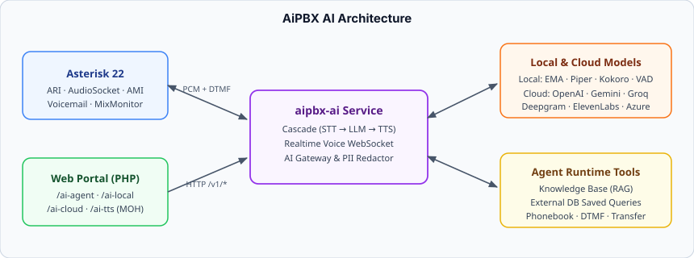
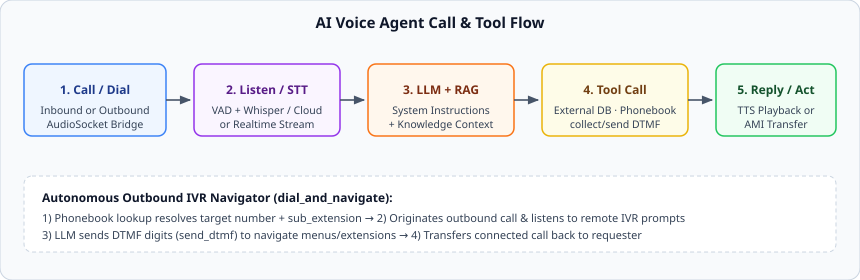

# AI Screens & Architecture (`/ai-agent`, `/ai-local`, `/ai-cloud`, `/ai-tts`, `/ai-voicemail`, `/ai-call-analysis`)

The **AI** and **AI Settings** menus organize voice agents, local models, cloud providers, and per-feature tools into dedicated tabbed pages:

- **AI Voice Agent (`/ai-agent`):** Built-in voice agents bridged via Asterisk ARI or AudioSocket, supporting **Cascade (STT → LLM → TTS)** and **Realtime** modes, structured prompts, Knowledge Base RAG, saved external DB queries, inbound and outbound DTMF (`collect_dtmf`, `send_dtmf`), and outbound IVR navigation (`dial_and_navigate`) with phonebook `sub_extension` lookup.
- **Local AI (`/ai-local`):** Install or remove the local AI runtime (`aipbx-ai`) and Ollama, download/run/stop Piper TTS, Faster-Whisper STT, ONNX embedding, and Ollama LLM models, and configure local defaults, languages, and Try playground.
- **Cloud AI (`/ai-cloud`):** Configure cloud AI provider accounts (OpenAI, Google Gemini, Groq, Deepgram, ElevenLabs, Azure, Amazon Polly, or OpenAI-compatible servers), monthly quotas, and test connections.
- **AI TTS Studio (`/ai-tts`):** Generate speech from text and save directly as PBX announcements, with synthesis history.
- **AI Voicemail (`/ai-voicemail`):** Enable/disable voicemail transcription and summary, choose per-feature engines, and inspect recent `ai_jobs` entries.
- **Call Quality Analysis (`/ai-call-analysis`):** Configure automated Call Quality Review (Auto-QA), review criteria, and inspect recent `ai_jobs` entries.
- **Knowledge Base (`/ai-knowledge`) & PBX Assistant (`/pbx-assistant`):** Assistant model binding, TXT/RAG knowledge base, and chat retention (defaults to 10 days; nightly pruning).

Legacy URLs `/ai-models` and `/ai-settings` permanently redirect (`301`) to `/ai-local` (with `?tab=cloud` → `/ai-cloud`, `?tab=assistant` → `/pbx-assistant`, `?tab=voicemail` → `/ai-voicemail`, `?tab=cdr` → `/ai-call-analysis`).

See also: [Cloud AI](cloud-ai.md) · [Local AI](local-ai.md)

## Realtime voice and the Asterisk media bridge

1. Open **AI Settings → Cloud AI → Connections** and configure a provider account with its API key.
   Set **Realtime model** if you want to override the account's default. OpenAI-compatible accounts also
   offer a **Realtime protocol** selector (automatic, OpenAI Realtime GA or Beta) and a WebSocket URL.
2. Open **AI → AI Agent**, select the account in the speech-to-speech field and choose a voice.
   Save and apply the changes. Leave that account field off to use Cascade.

Realtime is the connection from the AI service to the model provider, such as OpenAI Realtime or Gemini Live.
Asterisk connects to the AI service through ARI when ARI is configured, and through AudioSocket otherwise.

## Architecture Overview

## AI Voice Agent Call & Tool Flow

## Local language models with Ollama

Under **AI Settings → Local AI**, choose **Install / start Ollama**. Setup runs in the background and shows its progress or an error. It installs the official Linux archive and starts a service bound to `127.0.0.1:11434`, with Ollama cloud features disabled. Existing Ollama models are retained. This button does not download a model.

Models already installed in Ollama appear in the model list and Assistant model selector without requiring the Python speech runtime. Install the speech runtime separately to use the Hugging Face catalog. GGUF and safetensors language models are verified by SHA-256, imported into Ollama, and marked ready only after successful loading. Model architectures must be supported by Ollama; unsupported models show an error rather than a ready state.

Hugging Face access tokens are used only in memory for inspection and the initial download. They are never saved in manifests. Retrying a protected model download after a service restart requires supplying the token again.

Chat history defaults to ten days and is pruned nightly, including old messages in active conversations. Choosing **Off** deletes saved chats immediately and prevents subsequent chat persistence. PBX change audit records remain separate.
