# Call Normalization & Ingress Dialplan Rules

Call Normalization rules act as an intelligent **pre-filter** between subscriber endpoints and the PBX Outbound Routes.

---

## Why Separate Device Rules?

Different devices originate calls with completely different user habits:
1. **Desk Phones (`desktop` / `sip`):** Users frequently dial a trunk access prefix (`0` in Europe/Turkey, `9` in North America) before dialing an outside number (`00537...` or `91212...`).
2. **Mobile App (`mobile` / `mob-webrtc`):** Users tap contacts stored in their address book in full E.164 (`+90...`, `+1...`, `+49...`) or 10-digit national format (`537...`). Mobile users never enter an outside trunk code.
3. **Web Softphone (`web` / `webrtc`):** Browser-based agent softphone and CRM click-to-dial calls.

Without ingress normalization, supporting both desk phones and mobile apps required duplicated or conflicting outbound routes. With normalization rules, the dialed string is shaped into a standard format first.

---

## Safe Asterisk Dialplan Hierarchy

To guarantee that call centers, queues, faxes and IVRs are never disrupted:
1. **Internal Extensions & Features:** Evaluated first (`from-internal-pbx-ortak`, `featurecodes-pbx`). Numbers like `101`, `1002`, `*97` (Voicemail), `7000` (IVR) never reach normalization rules.
2. **Ingress Sub-Contexts:** Slices are applied only to calls leaving the PBX:
   - `from-internal-desktop` → includes `sub-norm-desktop-N`
   - `from-internal-mobile` → includes `sub-norm-mobile-N`
   - `from-internal-web` → includes `sub-norm-web-N`
3. **Single-Pass Ingress Pre-Filter & Loop Circuit Breaker:** Normalization operates as a single-pass pre-filter: once a rule matches and transforms the number, Asterisk routes directly to `from-internal-outbound-N`. A defense-in-depth hop guard (`__AIPBX_NORM_COUNT > 3`) acts as a fail-safe circuit breaker, guaranteeing that external dialplan loops or macro re-entrancy can never cause infinite recursion.

---

## Defaults and Rule Order

- **Desk phone "strip the outside-line 0" rule is off by default.** AiPBX's international format is `00` + country code, so with this rule `0049...` would become `049...`. Switch it on only when your desk phone users dial `0` for an outside line. Faxes and call forwarding also use the desk phone rules.
- **Country-specific rules** (e.g. Turkey: `+90` → `0`, `5XXXXXXXXX` → `05XXXXXXXXX`) are loaded with **Load defaults** for the selected country. An upgrade switches them off on installations that are not set up for that country.
- **Order:** when several rules match, Asterisk picks the most specific pattern (`_+90.` beats `_+X.`), not the row order. The simulator shows the rule that really applies.

---

## Live Normalization Simulator

On the **Trunks → Call Normalization (`/dialplan-rules`)** page, the interactive simulator lets administrators input any test number (e.g. `+905379902352` or `005379902352`), select the target device type, and inspect the real-time pattern match and resulting number.
