# Outbound Call Normalization

Outbound Call Normalization rules act as an intelligent **pre-filter** between subscriber endpoints and the PBX Outbound Routes.

---

## Why Separate Device Rules?

Different devices originate calls with completely different user habits:
1. **Desk Phones (`desktop` / `sip`):** Users frequently dial a trunk access prefix (`0` in Europe/Turkey, `9` in North America) before dialing an outside number (`00537...` or `91212...`).
2. **Mobile App (`mobile` / `mob-webrtc`):** Users tap contacts stored in their address book in full E.164 (`+90...`, `+1...`, `+49...`) or 10-digit national format (`537...`). Mobile users never enter an outside trunk code.
3. **Web Softphone (`web` / `webrtc`):** Browser-based agent softphone and CRM click-to-dial calls.

Without ingress normalization, supporting both desk phones and mobile apps required duplicated or conflicting outbound routes. With normalization rules, the dialed string is shaped into a standard format first.

---

## Safe Asterisk Dialplan Hierarchy

To guarantee that call centers, queues, faxes and IVRs are never disrupted:
1. **Internal Extensions & Features:** Evaluated first (`from-internal-pbx-ortak`, `featurecodes-pbx`). Numbers like `101`, `1002`, `*97` (Voicemail), `7000` (IVR) never reach normalization rules.
2. **Ingress Sub-Contexts:** Slices are applied only to calls leaving the PBX:
   - `from-internal-desktop` → includes `sub-norm-desktop-N`
   - `from-internal-mobile` → includes `sub-norm-mobile-N`
   - `from-internal-web` → includes `sub-norm-web-N`
3. **Single-Pass Ingress Pre-Filter & Loop Circuit Breaker:** Normalization operates as a single-pass pre-filter: once a rule matches and transforms the number, Asterisk routes directly to `from-internal-outbound-N`. A defense-in-depth hop guard (`__AIPBX_NORM_COUNT > 3`) acts as a fail-safe circuit breaker, guaranteeing that external dialplan loops or macro re-entrancy can never cause infinite recursion.

---

## Defaults and Rule Order

- **Desk phone "strip the outside-line 0" rule is off by default.** AiPBX's international format is `00` + country code, so with this rule `0049...` would become `049...`. Switch it on only when your desk phone users dial `0` for an outside line. Faxes and call forwarding also use the desk phone rules.
- **Country-specific rules** (e.g. Turkey: `+90` → `0`, `5XXXXXXXXX` → `05XXXXXXXXX`) are loaded with **Load defaults** for the selected country. An upgrade switches them off on installations that are not set up for that country.
- **Order:** when several rules match, Asterisk picks the most specific pattern (`_+90.` beats `_+X.`), not the row order. The simulator shows the rule that really applies.

---

## Live Normalization Simulator

On the **Trunks → Outbound Call Normalization (`/dialplan-rules`)** page, the interactive simulator lets administrators input any test number (e.g. `+905379902352` or `005379902352`), select the target device type, and inspect the real-time pattern match and resulting number.

---

## Carriers That Want E.164 (Twilio and Others)

Open the trunk and choose a country under **Send as E.164**. Every number sent to that trunk is converted with
that country's dialling plan, and **Try a number** shows the result before you save. With the United States
selected:

| Dialled | Sent |
| --- | --- |
| `4155550100` | `+14155550100` |
| `14155550100` | `+14155550100` |
| `011905321234567` | `+905321234567` |
| `+14155550100` | `+14155550100` |
| `911` | `911` |

- Numbers shorter than 7 digits, such as emergency and service numbers, and anything that is not plain digits are not changed.
- A number that starts with the country code counts as complete. A national number that happens to start with those digits and is dialled without its national prefix would be read the same way, so try your numbering in **Try a number**.
- It runs after the trunk's **Strip Prefix** and **Prepend Prefix**.
- The caller ID is separate: keep the last digits and prepend the code in the same trunk's settings, for example keep 10 and prepend `+1`.

An outbound route's **Prepend** field also accepts a leading `+`, for example `+1`.

---

## Inbound Call Normalization

**Trunks → Inbound Call Normalization** rewrites the numbers of incoming calls, for one trunk or for all of them:

- **Caller's number:** so a caller appears the same way whichever carrier delivered the call. `+4366412345678` can become `066412345678`, which can be called back and matches the blacklist and call history.
- **Dialled number:** runs after the trunk's "keep the last digits" setting, before the inbound route is matched.

**Ready-made rules for a country** replaces all the rules on the page with the usual rules for the caller's number, after asking, as on the outbound page. Or write your own: to show `+43...` callers as `0...`, use pattern `_+43.`, remove 3 digits, prepend `0`. **Test a number** shows the result before you press Apply. As on the outbound page, Asterisk picks the most specific pattern, not the first row, and a trunk's own rule comes before a rule for all trunks. Without rules, numbers stay as the carrier sends them.

## Extra SIP Headers

A trunk's **Advanced** tab can add SIP headers to its outgoing calls on outbound routes, one `Name: value` per line, for carriers that ask for one. Standard headers such as `From` and `Contact` cannot be set this way.

## Ready-Made Rules

A new installation has no rules for any country, on either page. Ready-made rules are only loaded when an administrator chooses a country and presses the button.

They come from one JSON file per country calling code, in `web/config/normalization_presets/`, such as `43.json`, with an `outbound` and an `inbound` list. To change a country's rules, or add a country, copy its file to `/var/lib/aipbx/normalization_presets/` and edit the copy. That copy is used instead, and updates leave it alone. Do not edit the shipped files: `aipbx-update` would refuse to run. A rule with a value that is not allowed is skipped.
