# Caller ID: what the other side sees

Several settings decide the number and the name that are shown on a call. This page shows them in the order they
run. The numbers that are dialled are on [How numbers change on a call](number-normalization.md).

## Outgoing calls

1. **A call that came in from another trunk** (a forwarded or transferred outside call) keeps its caller.
2. **On a normal outside route the first number that is set wins:** the route's *Caller ID override* for the trunk
   it tries, the user's *External Call CID* (**Extensions**), the trunk's *Default Outbound Caller ID*, or its
   *From User* when that is empty. With none of them the number the phone sent stays.
3. **On a route marked internal:** the override, then the user's *Internal Call CID*, then the phone's own number.
4. **Trunk format:** *Keep only the last N digits*, then *Prepend*, on whichever number was chosen; again from the
   original number for every trunk tried, so a fallback trunk with another format still works.
5. **Name:** when the trunk's *Send Display Name on Outgoing Calls* is off, the name is cleared before the call leaves. Fax calls never
   send a name.

*From User* also replaces the user part of the `From` header when it differs from the chosen number. Leave it empty
unless the carrier asks for it.

## Incoming calls

1. **Inbound Call Normalization** (caller rules) puts the caller's number in one form, whichever carrier delivered it.
2. **Blacklist** sees that form, so enter blacklisted numbers the same way.
3. **Phonebook:** the contact's name, asked for at most one second; a slow answer leaves the name the carrier
   sent. A VIP contact also gives the call priority in queues.
4. **CNAM plugin** (when installed): an outside lookup. It is skipped when there is a name already, unless its
   *Overwrite* option is on.
5. **Inbound route** by the DID, after the trunk's DID trim and the DID rules.
6. **Call modifiers** and **Dynamic Routing** can put a prefix in front of the name (for example `VIP`) and set the
   language or the queue priority.
7. **An AI agent before a queue** hands the call over with its summary: the name shows as `name | summary` on the
   agent's phone.

## Where the settings are

| Setting | Page |
|---|---|
| Caller ID override per trunk | **Outbound Routes** → the route's trunks |
| External / Internal Call CID | **Extensions** → the user |
| Default Outbound Caller ID, From User, Send Display Name on Outgoing Calls, Keep only the last N digits / Prepend | **Trunks** |
| Caller rules | **Inbound Call Normalization** |
| Blacklist | **Blacklist / Spam** |
| Names, VIP | **Phonebook** |
| CNAM | **Integration → Caller Name (CNAM)** (plugin) |
| Name prefix, language, priority | **Call Modifiers**, **Dynamic Routing** |
