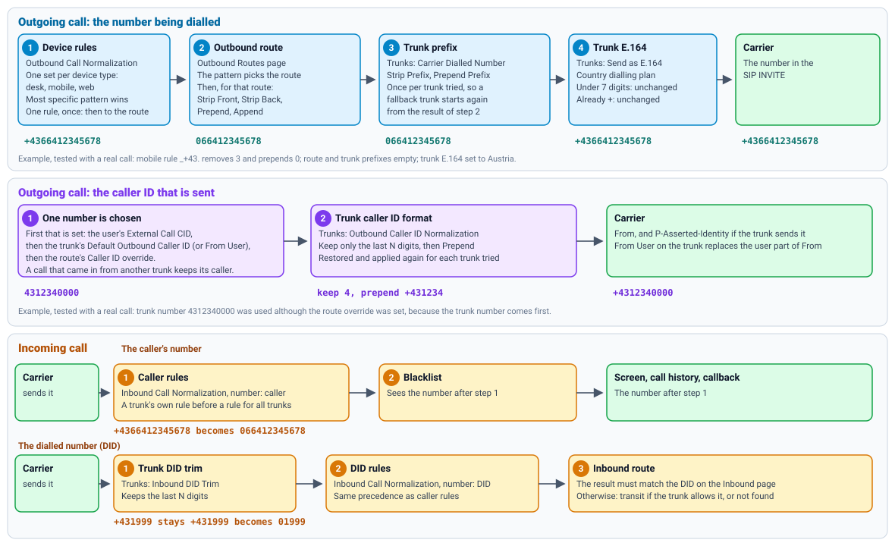

# How Numbers Change on a Call

Several pages can change a number. This page shows what runs, in what order, and which page to use. They do not replace
each other: on an outgoing call, a number goes through every step in turn, and each step works on the result of the one
before.

## Which page should I use?

| You want to | Use | Why there |
| --- | --- | --- |
| Accept the different ways people dial, such as `+43...` from a phone's contacts | **Outbound Call Normalization** | Runs first, so the routes only see one form |
| Treat desk phones and the mobile app differently | **Outbound Call Normalization** | The only step that knows the device |
| Remove an outside-line digit, such as `9` | **Outbound Routes**: Strip Front | It belongs to the route that the digit selects |
| Send a number in the form one carrier wants | **Trunks**: Send as E.164, or Strip and Prepend Prefix | Runs per trunk, so a fallback trunk with other rules still works |
| Set the caller ID of one person | **Extensions**: External Call CID | It is chosen first |
| Set a caller ID for everyone on a trunk | **Trunks**: Default Outbound Caller ID | Used for people without their own |
| Send every caller ID in a carrier's format | **Trunks**: Keep only the last N digits, and Prepend | Runs last, on whichever number was chosen |
| Show callers in one form, whichever carrier delivered them | **Inbound Call Normalization**: Caller's number | Runs first, so the blacklist and call history see the same form |
| Make a carrier's DID match your inbound routes | **Trunks**: Inbound DID Trim, for the last N digits | Simplest when only the length differs |
| Rewrite a DID in any other way | **Inbound Call Normalization**: Dialled number | Runs after the trim |

**Rule of thumb:** change a number in one place, at the step closest to the reason for the change. When a call goes wrong, check the steps in order.

## Outgoing call: the number

1. **Device rules** (Outbound Call Normalization). Only for calls from extensions, by device type, and only when the page's rules are switched on. Extensions, internal numbers and feature codes are matched first, so they never reach these rules. One rule runs, once, and its result goes straight to the routes. A call from another trunk (transit) skips this step.
2. **Outbound route** (Outbound Routes). The pattern chooses the route, and then Strip Front, Strip Back, Prepend and Append change the number for that route. The route's pattern sees the result of step 1.
3. **Trunk prefix** (Trunks). Strip Prefix and Prepend Prefix. If Strip Prefix is set and the number does not start with it, nothing changes, and Prepend Prefix is not added either.
4. **Trunk E.164** (Trunks). Numbers under 7 digits and numbers already starting with `+` do not change.

Steps 3 and 4 start again from the result of step 2 for every trunk tried, so one trunk's format does not reach the next.

## Outgoing call: the caller ID

1. **One number is chosen**, the first that is set:
   1. the user's External Call CID,
   2. the trunk's Default Outbound Caller ID, or its From User if that is empty,
   3. the route's Caller ID override for that trunk.

   A call that came in from another trunk keeps its caller. This order is for calls on normal outside routes. On a route marked internal, the route's override comes first.
2. **Trunk format.** Keep only the last N digits, then Prepend. It runs on whichever number was chosen, and again from the original number for each trunk tried.

From User on a trunk also replaces the user part of the From header when it differs from the chosen number, so the carrier can see it instead of the user's number. Leave it empty unless the carrier asks for it.

## Incoming call

**The caller's number**

1. **Caller rules** (Inbound Call Normalization).
2. **Blacklist.** It sees the number after step 1, so enter blacklisted numbers in that form.

**The dialled number**

1. **Trunk DID trim** (Trunks). Keeps the last N digits.
2. **DID rules** (Inbound Call Normalization).
3. **Inbound route.** The result is matched against the DIDs on the Inbound page.

On the inbound page a trunk's own rule comes before a rule for all trunks, and without rules numbers stay as the carrier sends them.

## Which rule wins within a page

On both normalization pages Asterisk picks the **most specific pattern**, not the first row: `_+43.` wins over `_+X.`. Use the test field on the page to see the result.

## Example

A mobile user taps `+4366412345678`. The trunk's E.164 is set to Austria. This was tested with a real call, and the trunk's SIP INVITE carried the numbers below.

| Step | Setting | Result |
| --- | --- | --- |
| Device rule | `_+43.`, remove 3, prepend `0` | `066412345678` |
| Route | `_0X.`, no changes | `066412345678` |
| Trunk prefix | Empty | `066412345678` |
| Trunk E.164 | Austria | `+4366412345678` |
| Caller ID | Trunk number `4312340000`, keep 4, prepend `+431234` | `+4312340000` |

See also: [Outbound Call Normalization and inbound rules](call-normalization.md) · [Outbound routes](outbound-routes.md)
