# System map (for administrators)

Where everything is on an installed AiPBX server and how to follow a problem from the portal to the
file, process or log behind it. Everything here is on the server itself: it works without internet
access. Paths are those of a standard `install.sh` installation; commands run as root (`sudo`).

Read it with [Troubleshooting](troubleshooting.md) (symptom → fix) and [Health](health.md) (the
automatic checks).

## 1. The big picture

Changes made in the portal are stored in the database first. **Apply** (top bar) writes the Asterisk
files under `/etc/asterisk/pbx/` and reloads Asterisk (section 5).

## 2. Source tree (`/opt/aipbx`)

`/opt/aipbx` is a git checkout of the release tag (`cat /opt/aipbx/VERSION`, `git -C /opt/aipbx
describe --tags`). Updates replace it; do not edit files there by hand.

| Path | What it is |
|------|------------|
| `install.sh` | Installs and upgrades everything (`--upgrade`); the reference for what is put where |
| `web/` | The portal (PHP), the API, cron/AGI scripts, translations |
| `web/index.php` | Front controller: every URL goes through it |
| `web/src/routes.php` | URL → controller map (one line per page) |
| `web/src/controllers/` | One controller per page: access check, POST actions, rendering |
| `web/src/services/` | Business logic (validation, saving, talking to Asterisk); most "why" comments live here |
| `web/src/repositories/` | Database queries |
| `web/src/sync/` | Generators of the Asterisk files (section 5) |
| `web/templates/views/<page>/` | Page HTML; `web/templates/layout*`, `sidebar_menu.php` the frame and menu |
| `web/assets/js/<page>.js` | Page script; `web/assets/css/` styles |
| `web/api/` | JSON endpoints used by pages (`/api/...`) and the mobile apps (`/api/mobile/...`) |
| `web/bin/` | Scripts run by cron, by Asterisk (`System()`/AGI) or by hand; symlinked into `/usr/local/bin` |
| `web/lang/<code>.php` | Interface texts, 23 languages (`t('key')` in PHP, `__('js.key')` in JS) |
| `web/db/migrations/` | Database schema changes (Phinx), applied by install/update |
| `web/auth.php` | Login session, role checks, page → permission module map (`getModuleKeyForPage`) |
| `web/config.php` | Reads `/etc/ai-pbx.env`, database connection, `t()` |
| `web/tests/` | PHPUnit tests (`vendor/bin/phpunit`), `bin/smoke.php` route/RBAC smoke test |
| `chat/` | Chat service (Go), built to `chat/aipbx-chat` |
| `ai/aipbx_ai/` | Local AI service (Python): models, voice requests, AudioSocket calls |
| `conf/sbin/` | Root tools installed to `/usr/local/sbin` (section 8) |
| `asterisk-config/` | Static Asterisk files installed once (the generated ones are in `/etc/asterisk/pbx/`) |
| `sounds/` | Sound lists and helpers |
| `android/`, `ios/` | Mobile apps (not used on the server) |
| `docs/` | These documents (also shown in the portal: *System → Help*) |

### From a page to its code

Take the URL of the page (e.g. `/phones`) and follow:

1. `web/src/routes.php` → `'/phones' => PhoneController::index`
2. `web/src/controllers/PhoneController.php` → which service it calls (`PhoneProvisionService`)
3. `web/src/services/PhoneProvisionService.php` → the logic; vendor files in `web/src/services/phones/`
4. `web/templates/views/phones/index.php` → the HTML; `web/assets/js/phones.js` → the buttons' script
5. Texts: search the shown text in `web/lang/en.php` to get its key, then the key in the code
6. Who may open it: `getModuleKeyForPage()` in `web/auth.php` and *System → Roles*

`grep -rn "something" /opt/aipbx/web/src` finds the rest; error messages in the logs name the file
and line.

## 3. Services

| Unit | What | Listens | Logs |
|------|------|---------|------|
| `asterisk` | Telephony engine | 5060 udp/tcp, 5061 tls, 8088 (local, WebSocket), 5038 (local, AMI), RTP 10000–20000 udp, UDPTL (T.38) 4100–4999 udp | `/var/log/asterisk/messages.log`, `security.log`; CLI `asterisk -rvvv` |
| `apache2` | Portal, API, `/ws` and `/chat/ws` proxy | 127.0.0.1:8443 (TLS), 80 | `/var/log/apache2/aipbx_ssl_error.log`, `aipbx_ssl_access.log` |
| `nginx` | Port 443 multiplexer (web vs TURNS) | 443 | `/var/log/nginx/stream.log`, `error.log` |
| `mariadb` | Database `asterisk` | 127.0.0.1:3306 | `journalctl -u mariadb` |
| `coturn` | TURN/TURNS relay for WebRTC media | 3478, 5349 | `/var/log/turnserver/turnserver.log` |
| `aipbx-chat` | Chat service (Go) | 127.0.0.1:8086 | `journalctl -u aipbx-chat` |
| `aipbx-ai` | Local AI models, voice requests, AudioSocket | 127.0.0.1:8790 (HTTP), 8791 (AudioSocket) | `journalctl -u aipbx-ai` |
| `postfix` | Outgoing mail (voicemail, fax, alerts) | 25 (local) | `journalctl -u postfix`, `mailq` |
| `fail2ban`, `firewalld` | Bans, firewall | – | `fail2ban-client status`, `firewall-cmd --list-all` |
| `chrony` | Time sync; NTP server for phones when switched on | 123 udp | `chronyc tracking`, `chronyc clients` |
| `aipbx-dnsmasq` | DHCP/TFTP for desk phones (*Network services*) | 67, 69 udp | `journalctl -u aipbx-dnsmasq` |
| `aipbx-vsftpd` | Read-only FTP for desk phones | 21, 40000–40049 | `/var/log/aipbx-ftp.log` |
| `aipbx-syslog` | Phone log receiver (*Network & devices → Phone logs*) | 514 udp | `/var/log/aipbx-phones/phones.log` |
| `aipbx-mdns` | `aipbx.local` name on the LAN | 5353 udp | `journalctl -u aipbx-mdns` |

`systemctl status <unit>` shows whether it runs; `journalctl -u <unit> -n 100` its recent log.
Units marked "when switched on" only run when the page enables them.

## 4. Files on the server

### Configuration and secrets

| Path | What |
|------|------|
| `/etc/ai-pbx.env` | Database users and passwords, AMI user, domain, paths. Read by the portal and scripts |
| `/var/lib/aipbx/settings.key` | Key that encrypts secrets stored in the database (SIP/trunk/API passwords, SecretBox) |
| `/etc/aipbx/ai.token` | Shared token between the portal and the local AI service |
| `/etc/ssl/aipbx/active.crt`, `active.key` | Certificate in use (copied to coturn and Asterisk by `aipbx-cert`) |
| `/etc/asterisk/pbx/` | Files generated by **Apply** (section 5); `*.prev` = the previous version |
| `/etc/asterisk/*.conf` | Asterisk base files installed once (`#include` the `pbx/` files) |
| `/etc/apache2/sites-available/aipbx.conf`, `conf-available/aipbx-*.conf` | Web server site, routing, security headers |
| `/etc/systemd/system/apache2.service.d/override.conf` | Lets the portal (and `aipbx-priv` through sudo) write `/etc/asterisk` and friends |
| `/etc/nginx/aipbx-stream.conf` | Port 443 multiplexer |
| `/etc/turnserver.conf` | coturn |
| `/etc/fail2ban/jail.d/*ai-pbx*`, `aipbx-web.local` | Ban rules (portal page *fail2ban*) |
| `/etc/sudoers.d/aipbx` | `www-data` may run `/usr/local/sbin/aipbx-priv` only |
| `/etc/cron.d/aipbx` | Scheduled jobs (section 7) |
| `/var/lib/aipbx-netsvc/` | DHCP/TFTP/FTP/syslog settings written by `aipbx-priv netsvc` |

Never paste `/etc/ai-pbx.env` or `settings.key` into a ticket: they hold every secret. Losing
`settings.key` makes the encrypted passwords in the database unreadable; it is in the backups.

### Data

| Path | What |
|------|------|
| `/var/spool/asterisk/monitor/` | Call recordings |
| `/var/spool/asterisk/voicemail/` | Voicemail |
| `/var/spool/asterisk/fax/` | Faxes (incoming, `outgoing/`) |
| `/var/lib/asterisk/sounds/` | Prompts (`tr/`, `custom/`), `/var/lib/asterisk/moh/` music on hold |
| `/var/lib/aipbx/chat_files/` | Chat attachments (when not on S3) |
| `/var/lib/aipbx/tftp/` | TFTP/FTP folder for desk phones |
| `/var/lib/aipbx/tts/` | Generated speech |
| `/var/lib/aipbx-ai/` | Local AI models and app configs |
| `/var/backups/aipbx-daily/` | Daily backup (`aipbx-backup`) |
| `/var/backups/aipbx/` | Backup taken before each update (`aipbx-update`) |

### Logs

| Path | What |
|------|------|
| `/var/log/asterisk/messages.log` | Calls, SIP, dialplan; first stop for "call does not work" |
| `/var/log/asterisk/security.log` | Failed SIP logins (fail2ban reads it) |
| `/var/log/apache2/aipbx_ssl_error.log` | PHP errors and warnings of the portal |
| `/var/log/apache2/aipbx_ssl_access.log` | Every web/API request (a WebSocket line is written when it closes) |
| `/var/log/aipbx/update.log` | Updates; `backup.log` backups; `web_login_failures.log` failed portal logins |
| `/var/log/fax_incoming.log`, `fax_outgoing.log` | Fax processing |
| `/var/log/aipbx-phones/phones.log` | Desk phone syslog (*Network & devices → Phone logs*) |
| `/var/log/aipbx-ftp.log` | FTP transfers of desk phones |
| `journalctl -t aipbx-voicemail` | Voicemail notifications (push, mail) |
| Portal: *Security → Audit log* | Who changed what in the portal, and Apply errors |

## 5. Apply: from the database to Asterisk

1. A page saves to the database and marks its area as pending (`sys_pending_sync`).
2. **Apply** (or `php /opt/aipbx/web/src/asterisk_sync.php`, which regenerates everything) runs the
   generators in `web/src/sync/`, writes each file atomically, keeps the previous one as `.prev`, and
   reloads only the Asterisk modules concerned. Calls are not dropped.
3. If a file cannot be written or Asterisk rejects it, the previous file is restored, the area stays
   pending and the error is shown and audit-logged.

| Generator (`web/src/sync/`) | File in `/etc/asterisk/pbx/` |
|------------------------------|------------------------------|
| `SyncExtensions` | `pjsip_endpoints.conf` (users' desk phone, WebRTC and mobile endpoints) |
| `SyncTrunks` | `pjsip_trunks.conf` |
| `SyncTransports` | `pjsip_transports.conf` (ports, NAT addresses, TLS) |
| `SyncInboundDialplan` | `extensions_inbound.conf` (inbound routes, DIDs) |
| `SyncOutboundDialplan` | `extensions_outbound.conf` |
| `SyncPermissions` | `extensions_permissions.conf` (dial permissions) |
| `SyncGeneralDialplan` | `extensions_general.conf` (internal dialling, voicemail, common contexts) |
| `SyncInternalNumbers` | `extensions_internalnumbers.conf` |
| `SyncFeatureCodes` | `extensions_featurecodes.conf` |
| `SyncIVRs`, `SyncTimeConditions` | `extensions_ivrs.conf` (time conditions are part of it) |
| `SyncRingGroups` | `extensions_ringgroups.conf` |
| `SyncQueues` | `queues_pbx.conf` |
| `SyncConferences` | `extensions_conferences.conf` |
| `SyncAiApps` | `extensions_ai_apps.conf` |
| `SyncWidgets` | `extensions_widgets.conf`, `pjsip_widgets.conf` |
| `SyncVoicemail` | `voicemail_general.conf`, `voicemail_pbx.conf` |
| `SyncMOH` | `musiconhold_pbx.conf` |
| `SyncRtpSettings`, `SyncUdptlSettings` | `rtp.conf`, `udptl.conf` |

To see what changed: `diff /etc/asterisk/pbx/<file>.prev /etc/asterisk/pbx/<file>`.

## 6. Database (`asterisk`)

`mysql asterisk` as root opens it. Main tables by area:

| Tables | What |
|--------|------|
| `sys_users`, `sys_roles`, `sys_role_permissions` | Users (extensions are users), roles, permissions |
| `sys_settings` | Most portal settings (key/value) |
| `sys_pending_sync` | Areas waiting for Apply |
| `sys_audit_log`, `sys_login_logs` | Audit log, logins |
| `sys_mobile_devices` | Signed-in mobile apps and their push tokens |
| `pbx_trunks`, `pbx_dids`, `pbx_outbound_routes`, `pbx_permission_*` | Trunks and routing |
| `pbx_ivrs`, `pbx_ivr_entries`, `pbx_time_*`, `pbx_ring_groups`, `pbx_queues`, `pbx_conferences` | Call flow |
| `pbx_phones`, `pbx_phones_waiting`, `pbx_phone_keys`, `pbx_phone_fetch_log` | Desk phone provisioning |
| `pbx_ai_apps`, `ai_requests`, `ai_cloud_usage`, `ai_tts_history`, `voicemail_ai` | AI |
| `asteriskcdr`, `asteriskcel`, `cdrs` | Call records (Asterisk CDR/CEL, portal call list) |
| `asteriskqueue`, `cc_queue_logs`, `cc_pause_logs`, `queues_details` | Call center |
| `chat_*` | Chat |
| `fax_received`, `fax_sent` | Fax |
| `health_checks`, `health_events` | Health page |
| `phinx_migrations` | Applied schema migrations |

## 7. Scheduled jobs (`/etc/cron.d/aipbx`)

| When | Job | What |
|------|-----|------|
| every minute | `aipbx_health.php` | Health checks; mails the admin when something breaks |
| every minute | `sync_queue_logs.php` | Queue log into `cc_queue_logs` |
| every minute | `fax_pending_sweep.sh` | Finishes faxes Asterisk left pending |
| every 5 min | `recordings_to_mp3.php` | Converts recordings |
| every 5 min | `fax_to_bucket.php`, hourly `voicemail_to_bucket.php` | Copies to S3 storage when configured |
| every 5 min | `provision_tftp.php` (www-data) | Writes desk phone files into the TFTP/FTP folder when that option is on |
| 02:30 | `aipbx-backup` | Daily backup |
| 03:15 | `fax_cleanup.sh` | Removes old fax files |
| 04:37 | `aipbx-update --check` | Looks for a new release (does not install it) |

## 8. Root tools (`/usr/local/sbin`)

| Tool | What |
|------|------|
| `aipbx-selftest` | Runs every health check now and prints OK/FAIL with the reason. Start here |
| `aipbx-update [--yes] [--check]` | Updates to the latest release: backup, `git checkout`, `install.sh --upgrade`, migrations; rolls back by itself on failure. Restarts Asterisk only when the release needs it (`scripts/asterisk-restart-needed.sh`); otherwise reloads and calls stay up |
| `aipbx-backup` | Database and configuration backup to `/var/backups/aipbx-daily` |
| `aipbx-cert` | Certificate handling (self-signed, Let's Encrypt, uploaded) |
| `aipbx-priv` | The portal's only way to root: fixed subcommands with validated arguments (`service`, `postfix`, `fw`, `f2b`, `cert`, `update`, `sounds`, `asterisk-lang`, `netsvc`, `net`, `ai`). Read it to see exactly what a page may do as root |
| `aipbx-readdress <old> <new> [--yes]` | Moves every setting and file from the old server address to the new one (preview first); same as *Network settings → Apply new address* |
| `aipbx-sounds` | Downloads and installs sound packs |
| `aipbx-ai-setup` | Installs or removes the local AI runtime |
| `aipbx-dhcp-probe <iface>` | Lists DHCP servers answering on a network |
| `aipbx-syslogd` | The phone log receiver (run by `aipbx-syslog`) |

## 9. Debugging recipes

**Start with** `aipbx-selftest` and the portal's *Health* page; most broken services show there.

### A page shows an error or a blank part
1. `tail -f /var/log/apache2/aipbx_ssl_error.log` and reload the page: the PHP error names file and line.
2. Browser developer tools → Console/Network: a failing `/api/...` call shows its JSON error.
3. Follow the page to its code (section 2).

### Apply fails or a change does nothing
1. The error is shown on Apply and kept in *Security → Audit log*.
2. `php /opt/aipbx/web/src/asterisk_sync.php` regenerates everything and prints errors.
3. `asterisk -rx "dialplan reload"` / `asterisk -rx "module reload res_pjsip.so"` and check
   `messages.log` for syntax errors in `/etc/asterisk/pbx/`.

### A call fails
1. `asterisk -rvvv`, make the call, read the dialplan steps (`Executing [...]`).
2. `asterisk -rx "pjsip show contacts"` — is the phone or trunk registered/reachable?
3. `asterisk -rx "pjsip set logger on"` (off again afterwards) shows the SIP messages;
   or capture: see [Troubleshooting → Capturing SIP](troubleshooting.md#capturing-sip).
4. Call records: portal *Reports*, or `SELECT * FROM asteriskcdr ORDER BY calldate DESC LIMIT 20;`.

### Browser or mobile app does not ring / no audio
1. `asterisk -rx "pjsip show contacts" | grep webrtc` — mobile endpoints are `<ext>-mob-webrtc`.
2. `/var/log/apache2/aipbx_ssl_access.log`: `GET /ws` with `101` = WebSocket opened (logged when it
   closes); `503` = Asterisk was not reachable at that moment.
3. Audio: [WebRTC, NAT and TURN](webrtc-nat.md); `/var/log/turnserver/turnserver.log`.
4. App push and background: [Troubleshooting → notifications](troubleshooting.md).

### Desk phone does not get its configuration
1. *Network & devices → Phones*: *Show the phone's file* shows exactly what it gets; *Network settings*
   shows the addresses the phones are told.
2. *Network & devices → Phone logs*: one tab each for the phone's own log (syslog), HTTPS, FTP, TFTP and DHCP,
   by IP or MAC.
3. On the server: `journalctl -u aipbx-dnsmasq`, `/var/log/aipbx-ftp.log`, files in
   `/var/lib/aipbx/tftp`.

### Mail is not sent
`mailq` (queue), `journalctl -u postfix -n 50`; settings: *System → Mail settings*.

### Fax
`/var/log/fax_incoming.log`, `/var/log/fax_outgoing.log`, `asterisk -rx "fax show sessions"`.

### Chat or AI
`journalctl -u aipbx-chat -n 100`, `journalctl -u aipbx-ai -n 100`;
`curl -s http://127.0.0.1:8790/v1/health` for the AI service.

### Login problems
`/var/log/aipbx/web_login_failures.log`; `fail2ban-client status aipbx-web` (banned addresses).

### Time
`chronyc tracking`; phones: `chronyc clients` (when NTP server is on).

## 10. Where is …? (feature → code)

| Feature | Start at |
|---------|----------|
| Extensions / users | `ExtensionController`, `SystemUserController`, `web/src/sync/SyncExtensions.php` |
| Trunks | `TrunkController`, `SyncTrunks.php` |
| Inbound / outbound routes | `DidRouteController`, `OutboundRouteController`, `SyncInboundDialplan.php`, `SyncOutboundDialplan.php` |
| IVR, time conditions | `IvrController`, `TimeConditionController`, `SyncIVRs.php`, `SyncTimeConditions.php` |
| Queues, call center | `QueueController`, `CcAgentController`, `CcSupervisorController`, `web/src/queue_helper.php` |
| Desk phones | `PhoneController`, `PhoneProvisionService`, `web/src/services/phones/<Vendor>Template.php`, `ProvisionController` (`/provision/`) |
| Network settings, address change | `NetworkSettingsController`, `NetworkSettingsService`, `aipbx-priv net`, `web/bin/readdress.php` |
| Network services, phone logs | `NetworkServicesService`, `PhoneLogService`, `aipbx-priv netsvc` |
| Web phone (browser) | `MyPhoneController`, `web/assets/js/header_phone.js` (top bar phone), `my_phone.js` |
| Mobile app API | `web/api/mobile/` |
| Push notifications | `web/src/services/push/`, `web/bin/push_dispatcher.php` |
| Voicemail | `SyncVoicemail.php`, `web/bin/voicemail_notify.php`, `voicemail_mail.php` |
| Fax | `Fax*Controller`, `web/bin/process_incoming_fax.sh`, `process_outgoing_fax_result.sh` |
| Chat | `chat/` (Go), `ChatController` |
| Local AI, voice requests | `ai/aipbx_ai/`, `AiModelsController`, `AiAppsController`, `SyncAiApps.php` |
| Cloud AI / TTS | `AiCloudController`, `AiTtsController`, `web/src/services/ai/` |
| Health checks | `web/src/services/health/HealthChecks.php`, `conf/sbin/aipbx-selftest` |
| Updates, backups | `conf/sbin/aipbx-update`, `aipbx-backup`, `SystemUpdateController` |
| Certificates | `conf/sbin/aipbx-cert`, `CertificateController` |
| Roles and permissions | `RoleController`, `web/auth.php` |
| Translations | `web/lang/`, [Translating](translating.md) |
